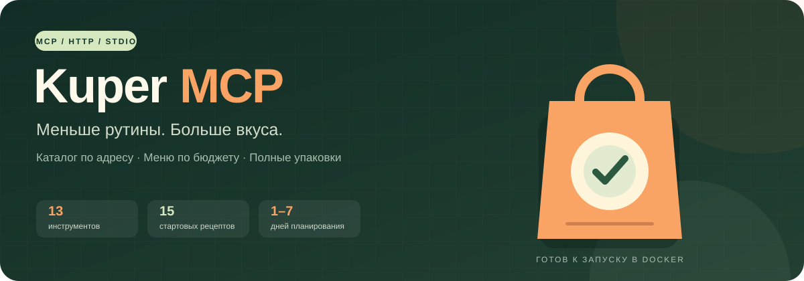
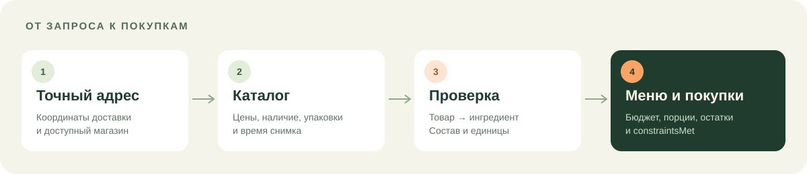

<div align="center">



# Kuper MCP

**От адреса доставки до меню и списка покупок — прямо в MCP-клиенте.**


[Установка](#установка) · [Docker](#docker) · [Инструменты](docs/tools.md) · [Настройки](docs/configuration.md)

</div>

Неофициальный TypeScript-сервер для чтения каталога Купера и планирования питания.
HTTPcloak обращается к API напрямую: браузер, Python и настройка профиля не нужны.
Сервер использует MCP SDK v1: **stdio** для локального процесса и **Streamable HTTP**
для общего Docker-сервиса.

- **Каталог по адресу:** магазины по координатам доставки, поиск товаров и сравнение цен.
- **Меню на 1–7 дней:** бюджет, число людей, калории, БЖУ, кухни, исключения и время готовки.
- **Полные упаковки:** суммирование ингредиентов, стоимость покупок и остатки.
- **13 инструментов, 15 рецептов:** можно передать свои рецепты и проверенные предложения.

## Установка

Нужен **Node.js 22.18+** с npm и доступ к npm registry при первой установке.
Скачайте репозиторий или клонируйте его, откройте каталог проекта и выполните:

```sh
node scripts/start.mjs
```

Launcher устанавливает закреплённый **pnpm 12.10.1**, зависимости по lockfile, собирает
TypeScript и запускает сервер. Вывод подготовки и логи идут в stderr; stdout выделен
для JSON-RPC. Сообщение `kuper-mcp ready (stdio)` означает, что сервер ждёт MCP-запросов.
Это не веб-страница и не интерактивный чат в терминале.

Для настройки скопируйте `.env.example` в `.env`. Этот шаг необязателен.
Launcher загружает файл из корня проекта, даже если клиент запускает его из другого каталога.
Переменные клиента имеют приоритет. Для уже установленных зависимостей и запуска без npm registry
используйте `node scripts/start.mjs --no-install`; сборка TypeScript всё равно выполняется.

### Подключение к MCP-клиенту

Добавьте сервер в конфигурацию клиента. Замените путь на **абсолютный путь** к вашему проекту:

```json
{
  "mcpServers": {
    "kuper": {
      "command": "node",
      "args": ["/absolute/path/to/kuper-mcp/scripts/start.mjs"]
    }
  }
}
```

В Windows используйте путь вида `C:/projects/kuper-mcp/scripts/start.mjs`.
Дайте первому запуску до 180 секунд на установку и сборку, если клиент позволяет настроить
таймаут запуска. Примеры: [Node.js](examples/mcp.json) и [Docker](examples/mcp.docker.json).

## Docker

Нужен работающий **Docker Engine в режиме Linux containers**.
Node.js на хосте для запуска контейнера не требуется.

```sh
docker compose up -d --build
```

Сборка выполняет установку и компиляцию заранее. Готовый контейнер запускает собранный
сервер от пользователя `node`, содержит только production-зависимости и не устанавливает
пакеты при старте. Для чтения живого каталога ему нужен доступ к `kuper.ru`.

Подключение контейнера к MCP-клиенту:

```json
{
  "mcpServers": {
    "kuper": {
      "url": "http://127.0.0.1:8815/mcp"
    }
  }
}
```

Compose поддерживает один контейнер сервиса. Повторная команда обновляет его;
подключения разных окон и чатов используют общий каталог, очередь и кэш.
Порт опубликован только на `127.0.0.1`. Остановка сервиса:

```sh
docker compose down
```

Проверка образа из проекта с установленными Node.js-зависимостями:

```sh
node scripts/smoke-docker.mjs
```

Она проверяет отдельный временный stdio-контейнер и удаляет его после проверки.
Для постоянного сервиса используйте HTTP-адрес выше. При сборке отдельно проверяется
загрузка нативной библиотеки HTTPcloak; доступ к живому каталогу этим не подтверждается.

### Подключение Docker к Codex

После сборки образа `kuper-mcp:local` выполните:

```sh
codex mcp add kuper --url http://127.0.0.1:8815/mcp
```

Либо добавьте содержимое [examples/codex.docker.toml](examples/codex.docker.toml)
в `~/.codex/config.toml` (Windows: `%USERPROFILE%\.codex\config.toml`). Если секция
`[mcp_servers.kuper]` уже существует, обновите её вместо создания второй.
Перезапустите Codex; в CLI проверьте подключение командой `/mcp`.

Docker Desktop должен работать в режиме Linux containers. Сначала запустите
`docker compose up -d --build`. Codex подключается к сервису и не создаёт контейнеры.
Старый вариант `docker run --rm --init -i kuper-mcp:local` по-прежнему поддерживает stdio,
но создаёт отдельный контейнер на каждое подключение; `--rm` удаляет его только после остановки.

[Официальная инструкция Codex MCP](https://developers.openai.com/codex/mcp).

## Команды MCP

Сервер предоставляет 13 инструментов. Их вызывает MCP-клиент; это не команды оболочки.

| Инструмент                   | Что делает                                                                                                   |
| ---------------------------- | ------------------------------------------------------------------------------------------------------------ |
| `kuper_list_cities`          | Ищет город по названию в конфигурации Купера; поле городов может отсутствовать.                              |
| `kuper_suggest_addresses`    | Ищет адрес внутри указанного `cityId`; координаты могут отсутствовать.                                       |
| `kuper_list_stores`          | Показывает магазины, обслуживающие точные координаты доставки, с пагинацией.                                 |
| `kuper_search_products`      | Ищет товары в одном `storeId`; возвращает цену, наличие, упаковку, время снимка и следующую страницу.        |
| `kuper_search_city_products` | Ищет товары на первой странице до пяти магазинов для адреса; сообщает об ограничении выборки.                |
| `kuper_compare_products`     | Сравнивает переданные снимки товаров по ₽/кг, ₽/л и ₽/шт; самостоятельно цены не обновляет.                  |
| `kuper_list_recipes`         | Возвращает стартовые рецепты с фильтрами по кухне и типу питания.                                            |
| `kuper_match_ingredients`    | Ищет до 30 ингредиентов в одном магазине и предлагает товары для проверки; не выбирает замену автоматически. |
| `kuper_plan_week`            | Рассчитывает меню, бюджет и БЖУ по переданным снимкам товаров и ограничениям.                                |
| `kuper_plan_week_live`       | Загружает цены явно выбранных товаров через каталог и рассчитывает меню; учитывает TTL кэша.                 |
| `kuper_build_shopping_list`  | Суммирует ингредиенты выбранных блюд, округляет упаковки, считает стоимость и остатки.                       |
| `kuper_session_status`       | Показывает очередь, кэш, паузу после лимита и последнюю ошибку; не обращается к Куперу.                      |
| `kuper_session_reset`        | Закрывает HTTP-сессию и очищает кэш; сохраняет паузу после лимита и не устраняет проверку сайта.             |

Также доступны ресурс `kuper://recipes` и prompt `plan_weekly_menu`.
[Параметры и полный сценарий работы](docs/tools.md).

## Реальный пример: сравнение цен на мясо

Запрос из реальной сессии, отредактированный для читаемости:

> Я живу в Новосибирске, Лескова, 35. Нужно купить 2 кг курицы, немного утки,
> мякоть говядины, фарш и индейку. Найди через Kuper MCP, где выгоднее по цене и качеству.
> Курицу лучше частями — ноги и филе, но если целая намного выгоднее, можно и её.

Клиент определил координаты дома, получил магазины доставки через `kuper_list_stores`
и сравнил подходящие товары в «Ленте», METRO, «Ашане», «Чижике», «Пятёрочке» и «Калине-Малине».
Например, для мякоти говядины был выполнен вызов `kuper_search_products`:

```json
{
  "storeId": "135331",
  "query": "говядина мякоть"
}
```

Фрагмент реального ответа, с сокращением остальных полей и товаров:

```json
{
  "data": {
    "products": [
      {
        "id": "37574675711",
        "storeId": "135331",
        "name": "Говядина мякоть без кости категория А охлажденная",
        "priceRub": 999.99,
        "available": true,
        "packageSize": null,
        "priceType": "per_kilo",
        "observedAt": "2026-10-17T07:14:03.529Z"
      }
    ],
    "nextPage": 2
  }
}
```

Результат сравнения **17 октября 2026 года** — лучшие найденные предложения в проверенной
выборке, а не гарантия минимальной цены по всему городу:

| Покупка         | Магазин   | Товар                                       | Цена из каталога     | Цена за кг   |
| --------------- | --------- | ------------------------------------------- | -------------------- | ------------ |
| Куриные бёдра   | Ашан      | «Алтайский бройлер», охлаждённые            | 219,98 ₽/кг          | **219,98 ₽** |
| Куриное филе    | Пятёрочка | «Алтайский бройлер», охлаждённое, ~1 кг     | 419,99 ₽ за ~1 кг    | **419,99 ₽** |
| Немного утки    | Ашан      | Филе грудки утёнка «Улыбино», замороженное  | 500 ₽/кг             | **500 ₽**    |
| Мякоть говядины | Лента     | Без кости, категория А, охлаждённая         | 999,99 ₽/кг          | **999,99 ₽** |
| Домашний фарш   | Чижик     | Свино-говяжий «Сибагро», охлаждённый, 400 г | 149 ₽ за упаковку    | **372,50 ₽** |
| Филе индейки    | Пятёрочка | Грудка «Инди», охлаждённая, 500 г           | 359,99 ₽ за упаковку | **719,98 ₽** |

В итоговом ответе: 1 кг бёдер из «Ашана» и примерно 1 кг филе из «Пятёрочки» — около
**640 ₽ за 2 кг курицы без доставки**. Для одного заказа предложено начать с «Ашана»;
говядина отдельно оказалась выгоднее в «Ленте». Если нужен чисто говяжий фарш, в «Чижике»
найден охлаждённый «Вернер» за **269 ₽ / 400 г** (672,50 ₽/кг).

На момент запросов каталог подтверждал наличие выбранных позиций. Свежесть конкретной
упаковки и состав фарша не проверялись. Доставка и сборы не включены; веса остальных видов
мяса пользователь не задал, поэтому общая стоимость всей корзины не рассчитывалась.
Цены и наличие в этом примере — исторический снимок, для покупки нужен новый поиск.

## Пример запроса меню

> Составь меню на день для одного человека за 1000 ₽ в Новосибирске.
> Используй мой точный адрес доставки, учти полные упаковки и оставь резерв на доставку.



Клиент определяет точные координаты, выбирает магазин, получает рецепты и проверяет
соответствие товаров ингредиентам. Затем передаёт выбранные товары планировщику.
Результат включает меню, покупки, остатки и признак `constraintsMet`.
[Все инструменты и полный сценарий](docs/tools.md).

## Ограничения данных

Внутренний API Купера может измениться и не является публичным контрактом.
Проект не связан с Купером и не оформляет заказы или оплату.

- Цена в выдаче не подтверждает наличие: неизвестное наличие остаётся `null`.
- Планировщик использует только товары с подтверждёнными ценой, наличием и подходящей упаковкой.
  Если данных недостаточно, он возвращает `insufficient_data`.
- Поиск может включать посторонние товары. Привязки к ингредиентам и состав проверяются отдельно.
- Весовые товары без известного шага покупки не используются. Проверяйте единицы на этикетке:
  масса масла, объём молока и масса консервов не взаимозаменяемы.
- КБЖУ рецептов оценочные. Доставка, сборы, минимальный заказ и слот проверяются отдельно.
- Кэш цен по умолчанию живёт 5 минут. Расчёт по переданным снимкам не обновляет каталог.
- Если списка городов нет, возвращается `SCHEMA_CHANGED`: используйте проверенный cityId
  для подсказок адреса либо точные координаты для списка магазинов.

## Разработка

После установки зависимостей:

```sh
pnpm run dev
pnpm run check
```

Без глобального pnpm: `npm exec --yes --package=pnpm@12.10.1 -- pnpm run check`.
`check` запускает Prettier, Oxlint, TypeScript и тесты, включая настоящий stdio-процесс.
CI проверяет Windows/Linux с Node.js 22/24 и отдельно сборку Docker с MCP smoke.

| Каталог            | Назначение                                             |
| ------------------ | ------------------------------------------------------ |
| `apps/mcp`         | MCP-инструменты, ресурс рецептов, prompt, stdio и HTTP |
| `packages/core`    | Типы, нормализация каталога, цены и единицы            |
| `packages/scraper` | HTTPcloak, очередь, кэш и ограничения запросов         |
| `packages/planner` | Планирование, упаковки и библиотека рецептов           |
| `scripts`          | Установка и проверка контейнера                        |
| `docs`             | Настройки, инструменты и SVG-иллюстрации               |

[Как вносить изменения](CONTRIBUTING.md) · [Настройки и диагностика](docs/configuration.md)
